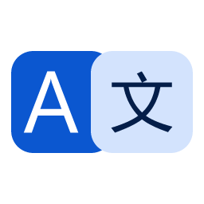

<div align="center">



# Screen Translator

**Fast, lightweight OCR & screen translation — built in native Rust with a Material Design 3 UI.**

[English](README.md) · [简体中文](README.zh-CN.md)

[](https://github.com/arlo-rin/screen-translator/actions/workflows/ci.yml)
[](https://github.com/arlo-rin/screen-translator/actions/workflows/release.yml)
[](LICENSE)
[](https://github.com/arlo-rin/screen-translator/releases)
[](https://www.rust-lang.org/)

[**Highlights**](#-highlights) ·
[**Quick Start**](#-quick-start) ·
[**Hotkeys & CLI**](#-hotkeys--cli) ·
[**Translation & OCR**](#-translation--ocr) ·
[**Building**](#-building-from-source) ·
[**Credits & License**](#-credits--license)

</div>

---

## ✨ Highlights

- **Five ways to view translations**
  - **Over the original** *(default)* — paints the translation directly over the captured text, matching size and surface colour without stealing focus from your game or app.
  - **Subtitles** — displays a clean, movie-style subtitle bar at the bottom or top of the screen with configurable size, opacity, and optional original text above.
  - **Popup card** — floating frosted card beside the selection with copy, text-to-speech, and live-watch toggles.
  - **Separate window** — two-column original/translation window that can be pinned on top.
  - **Clipboard only** — copies the result silently without drawing anything on screen.
- **Live region watching** — select a dialogue box, window, or display once (`Alt+Shift+Q`) and translations update automatically whenever the on-screen text changes.
- **Fast on-device OCR (Windows)** — uses built-in `Windows.Media.Ocr` by default so dialogue captures finish in tens of milliseconds without uploading screenshots; falls back to online OCR when a local language pack isn't installed or when stylised fonts need it.
- **Five translation engines with automatic fallback** — `AI`, `DeepL`, `Yandex`, `Google`, and `Alibaba Cloud MT`, tried in your priority order.
- **Isolated AI profiles & vision support** — supports OpenAI-compatible, Anthropic Messages, and Google Gemini protocols with 9 built-in presets (including local `Ollama` and `LM Studio`), per-preset saved credentials/prompts, and optional direct-screenshot vision mode.
- **Material Design 3 interface** — unified Light / Dark / System theme, borderless custom M3 title bar, distinct M3 tonal sidebar icons, and **14 interface languages** with native CJK UI font selection.
- **Low memory footprint** — pure native Rust (`eframe`/`egui`) with no embedded browser runtime, zero-copy memory-mapped system fonts (`MapViewOfFile` on Windows), and low-frequency tray idle scheduling.

> **Custom build note:** This fork removes the upstream self-updater and donation prompts. Check the [Releases](https://github.com/arlo-rin/screen-translator/releases) page for new builds.

---

## 🚀 Quick Start

Download the standalone binary for your platform from [**Releases**](https://github.com/arlo-rin/screen-translator/releases) (no installer required):

- Windows: `screen-translator-windows-x86_64.exe`
- macOS (Universal): `screen-translator-macos-universal`
- Linux: `screen-translator-linux-x86_64`

1. Launch the app — it stays quietly in the **system tray** (Windows/Linux) or **menu bar** (macOS).
2. Press **`Alt+Q`** anywhere on screen.
3. Drag a rectangle around any text (or press **`Tab`** to switch between **Region**, **Window**, and **Full screen**).
4. Release the mouse button to see the translation.
5. Click anywhere else or press **`Esc`** to dismiss.

---

## ⌨️ Hotkeys & CLI

### Global Hotkeys

All shortcuts can be customised or cleared in *Settings → Keyboard shortcuts*:

| Default Shortcut | Action |
|---|---|
| `Alt+Q` | Translate a dragged region |
| `Alt+Shift+W` | Translate a clicked window |
| `Alt+Shift+F` | Translate the full screen under the cursor |
| `Alt+Shift+R` | Repeat the last capture without re-selecting |
| `Alt+Shift+Q` | Start / stop **Live translation** on an area |
| *(Unbound)* | Hide the current translation (`Esc` also hides floating results) |

**Single-key bindings (no modifier required):** `F1`–`F24`, `Insert`, `Delete`, `Home`, `End`, `Page Up`, `Page Down`, and on Windows mouse side buttons **`Mouse4 (Back)`** / **`Mouse5 (Forward)`** can be bound directly on their own.

### While Capturing

| Input | Action |
|---|---|
| `Tab` | Cycle mode: Region → Window → Full screen |
| `Space` (hold) | Move the current selection rectangle |
| **Right click** | Discard current selection and draw again |
| `Esc` | Cancel capture |

### Command Line & Portable Profiles

```bash
screen-translator --settings              # Open the settings window on launch
screen-translator --settings engine       # Jump directly to a settings page
screen-translator --region 100,200,800,160  # Translate x,y,w,h immediately
screen-translator --help                  # Show CLI help
```

- **Settings pages:** `general`, `keys`, `languages`, `engine`, `appearance`, `history`, `logs`, `about`
- **Portable / multi-profile:** Set the `SAKURA_CONFIG_DIR` environment variable to isolate `config.toml`, `logs/`, and the single-instance lock into a custom folder so multiple profiles can run side by side.

---

## 🌐 Translation & OCR

### Engines

Engines are attempted top-to-bottom until one succeeds:

1. **AI Translator** — OpenAI-compatible, Anthropic Messages, and Google Gemini protocols. Includes presets for Anthropic Claude, OpenAI, Google Gemini, OpenRouter, DeepSeek, Groq, Mistral, Ollama (local), and LM Studio (local). Each preset keeps its own isolated profile (endpoint, model, encrypted key, temperature, custom instructions, timeout, and Vision toggle).
2. **DeepL** — API key (supports both Free `:fx` and Pro keys).
3. **Yandex** *(enabled by default, no key needed)*.
4. **Google** *(enabled by default, no key needed)*.
5. **Alibaba Cloud MT** — AccessKey ID & Secret with selectable official endpoints (`mt.aliyuncs.com`, Hangzhou, Singapore, Riyadh, Dubai).

On Windows, API keys and secrets are sealed at rest using Windows DPAPI.

### Text Recognition (OCR)

- **Automatically *(default)*:** Uses local OS OCR on Windows when a matching language pack is installed and produces results; otherwise falls back to online OCR.
- **On this computer:** Strict local recognition — screenshots never leave your machine.
- **Online:** Always uses online OCR (helpful for languages without local packs or stylised game typography).

---

## 📋 Platform Requirements

<details>
<summary><b>Windows (10 / 11 x64)</b></summary>

- No external runtime dependencies required.
- Add language packs in *Windows Settings → Time & language → Language & region* to enable on-device OCR for additional languages.
- For full-screen games, use **Borderless Windowed** mode if an exclusive full-screen game prevents desktop overlays from appearing on top.

</details>

<details>
<summary><b>macOS (13+, Apple Silicon & Intel)</b></summary>

Grant permissions in *System Settings → Privacy & Security* on first run:
- **Screen Recording** — required for capturing screen content.
- **Accessibility** — required if global hotkeys do not fire.

Runs as a menu-bar agent (no Dock icon, no separate Space) so overlays stay on top of full-screen apps.

</details>

<details>
<summary><b>Linux (X11 / Wayland)</b></summary>

Optional desktop services used when available:
- **Secret Service** (GNOME Keyring / KWallet) for credential encryption
- **AppIndicator** panel support for the tray icon
- **speech-dispatcher** (`spd-say`) for text-to-speech playback

</details>

---

## 🛠️ Building from Source

### Prerequisites

- [Rust](https://rustup.rs/) stable toolchain
- **Windows:** MSVC Build Tools + Windows SDK
- **macOS:** Xcode Command Line Tools (`xcode-select --install`)
- **Linux (Debian/Ubuntu):**
  ```bash
  sudo apt install pkg-config clang libclang-dev libgtk-3-dev \
    libxcb1-dev libxcb-randr0-dev libxcb-shm0-dev libxcb-xfixes0-dev \
    libxkbcommon-dev libwayland-dev libgl1-mesa-dev \
    libayatana-appindicator3-dev libpipewire-0.3-dev libdbus-1-dev \
    libgbm-dev libxdo-dev
  ```

### Build & Test

```bash
cargo build --release   # Output: target/release/screen-translator(.exe)
cargo test              # Run unit tests
cargo test -- --ignored # Run live-display capture tests
```

---

## 🔖 Versioning & CI

`Cargo.toml` is the single source of truth for the version. Pushing a new version on `main` triggers `.github/workflows/release.yml` to build Windows, macOS Universal, and Linux binaries and publish tag `vX.Y.Z`.

---

## ⚠️ Disclaimer

This software is provided **"as is"**, without warranty of any kind. Third-party translation, OCR, and AI services are subject to their respective Terms of Service and billing policies, and unofficial endpoints may change or stop working without notice.

---

## 👤 Credits & License

- Original author: [@クシススミタ](https://github.com/Kushisusumita)
- Custom fork maintainer: [@arlo-rin](https://github.com/arlo-rin)
- License: [MIT](LICENSE)
